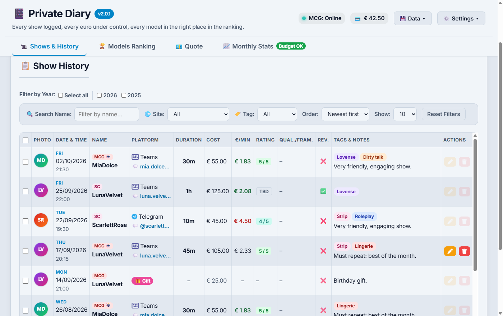
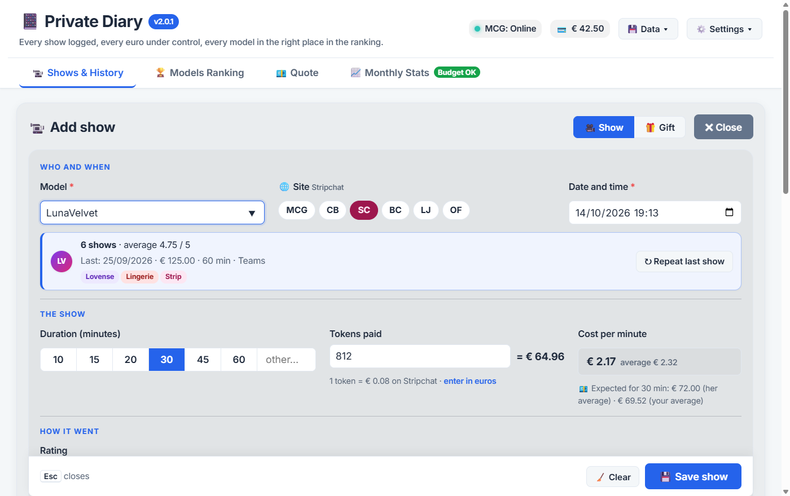
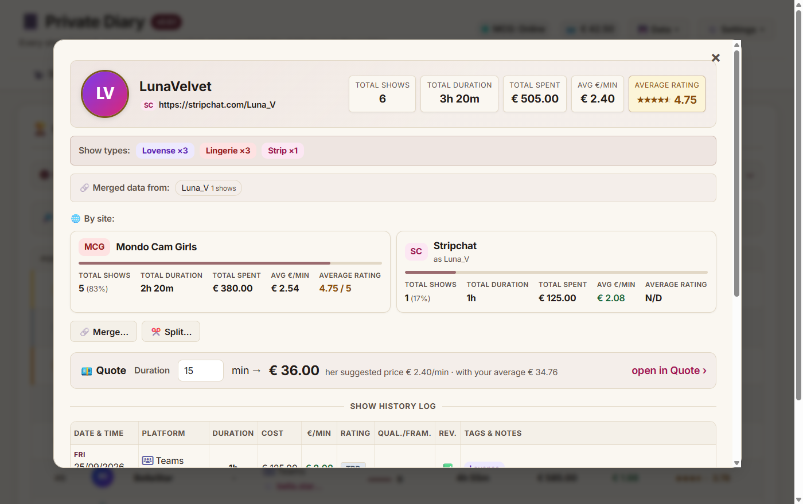
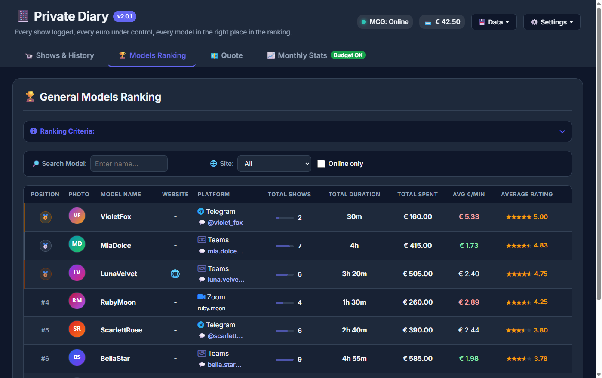
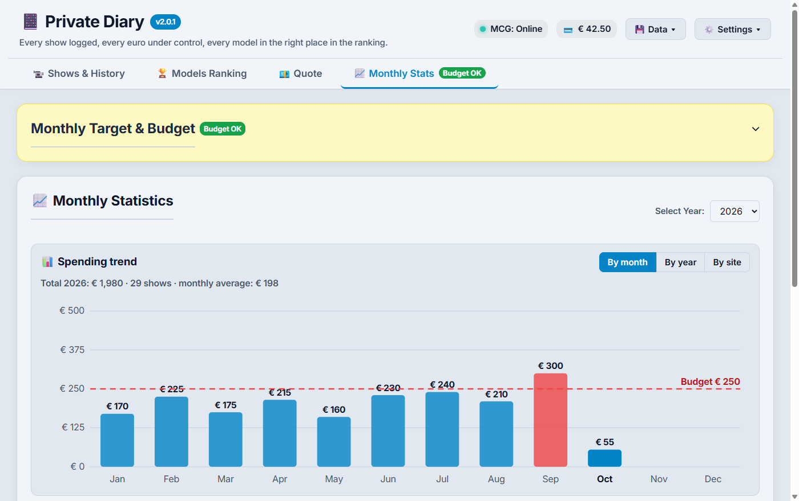

<div align="center">


# Private Diary

**Your private cam-show diary: every session logged, every euro under control, every model in the right place in the ranking.**

[](https://github.com/blackcornercode/private-diary/releases)

[](https://github.com/blackcornercode/private-diary/actions/workflows/test.yml)
[](LICENSE)

🇬🇧 English · [🇮🇹 Italiano](README.it.md)



</div>

## ✨ Features

- 📝 **Smart show log**: model mini-card with her stats, *repeat last show*, quick durations, live **€/min** compared with your average, colour-coded ratings.
- 💶 **Quote before you buy**: a suggested €/min for every model (from her last 5 shows, per site), the expected price for any duration and a check of the asked price against her average and your overall average.
- 🏆 **Model ranking**: average rating, number of shows, total time and spending, average €/min, plus a detailed card for every model.
- 🏷️ **Custom tags**: colour tags for the type of show, filters, bulk editing and a "show types" summary for each model.
- 🌐 **Any cam site**: every show records the site you bought it on (Mondo Cam Girls, Chaturbate, Stripchat… or your own), with colour badges, filters, per-site ranking and a spending chart by site.
- 📄 **CSV import and export**: import the purchase history downloaded from any site (columns guessed automatically, preview, duplicate check, tokens converted to euros) and export your history for Excel.
- 📊 **Budget and charts**: monthly budget with OK/KO badge, spending chart by month or by year, monthly breakdown.
- 🔄 **Mondo Cam Girls sync**: imports your transactions (refunds included) with your own login, shows who is **online**, flags **suspended** or **removed** profiles.
- 🔒 **Privacy first**: PIN lock with auto-lock, blurred photos, neutral window name and icon ("Agenda"), a customisable hotkey to hide the app instantly.
- 🎨 **Four themes**, including *Burgundy & Gold* inspired by mondocamgirls.com, adjustable text size, interface in Italian, English, Spanish, French, German, Portuguese, Romanian and Russian.
- 💾 **Your data stays with you**: everything is stored locally, with atomic saves, automatic backup copies and JSON export/import.

## 📸 Screenshots

| Add / edit a show | Model card |
| :---: | :---: |
|  |  |
| **Ranking** (dark theme) | **Spending chart and budget** |
|  |  |

<sub>Screenshots taken with made-up demo data (`npm run screenshot`).</sub>

## ⬇️ Download

From the [latest release](https://github.com/blackcornercode/private-diary/releases/latest) (Windows 10/11):
- **`PrivateDiary-<version>-setup.exe`** (recommended): installs the app for your user only, no administrator rights needed, with Start menu and desktop shortcuts. Uninstalling keeps your data.
- **`PrivateDiary-<version>-portable.exe`**: runs without installation.

### 🛡️ Antivirus or SmartScreen warnings

The executable is not digitally signed and, being new, has no "reputation" yet: Windows SmartScreen and some antivirus programs (for example AVG and Avast, with generic detections such as *IDP.ALEXA*) may block it as a precaution. It is a false positive:
- with SmartScreen choose **More info › Run anyway**;
- for an independent check, upload the file to [VirusTotal](https://www.virustotal.com), which scans it with about 70 antivirus engines;
- prefer the installer: on every launch the portable version unpacks itself into a temporary folder, a behaviour some antivirus programs find suspicious;
- all the source code is in this repository and you can build it yourself (`npm run dist`).

## 🚀 Getting started

1. **Choose your sites**: on first launch the app asks which cam sites you buy shows on. Only those appear in the form, and the Mondo Cam Girls features are switched on only if you use it.
2. **Add your first show** with **＋ New show**, or bring in your history: from Mondo Cam Girls via the **💾 Data** menu (**🔄 Sync MCG** for the latest transactions, **📜 Full MCG history** for every page), from any other site via **📥 Import from CSV**.
3. **Set a monthly budget** in **Monthly Stats**: the badge next to the tab tells you at a glance whether you are within it.
4. **Protect the app** from **⚙️ Settings › 🔒 Privacy**: PIN, blurred photos, neutral name and the hide hotkey (default **Ctrl+Shift+H**).

The full user guide (in Italian) is in [docs/GUIDA.md](docs/GUIDA.md).

## 🔐 Your data

- Shows, tags and settings are stored only on your computer, in `%APPDATA%\gestioneshow`.
- The app only talks to **mondocamgirls.com**: to check which models are online, to verify profiles and load their photos, and, when you ask for it, to read your transactions with your own login.
- The PIN protects the open app; **it does not encrypt the data files**.

## 🛠️ Build from source

```bash
npm install
npm start          # run the app
npm test           # automated tests
npm run dist       # Windows installer and portable executable in dist/
```

Architecture, tests and build details (in Italian): [docs/SVILUPPO.md](docs/SVILUPPO.md). Version history: [CHANGELOG.md](CHANGELOG.md). Where the project is heading (multi-site support): [docs/ROADMAP.md](docs/ROADMAP.md).

## ⚠️ Disclaimer

Private Diary is an independent project and is **not affiliated with, endorsed or sponsored by Mondo Cam Girls**; names and trademarks belong to their owners. The app only reads pages you could open yourself, with your own account, and keeps everything on your computer. It is meant for adults (18+): use it in accordance with the terms of the sites you use.

## ✉️ Contact

Ideas, bug reports or questions: **[blackcornermail@gmail.com](mailto:blackcornermail@gmail.com)**, or open an [issue](https://github.com/blackcornercode/private-diary/issues/new/choose). In the app: **? › ✉️ Contatti**.

## 📄 License

[ISC](LICENSE) © 2026 The Black Corner
